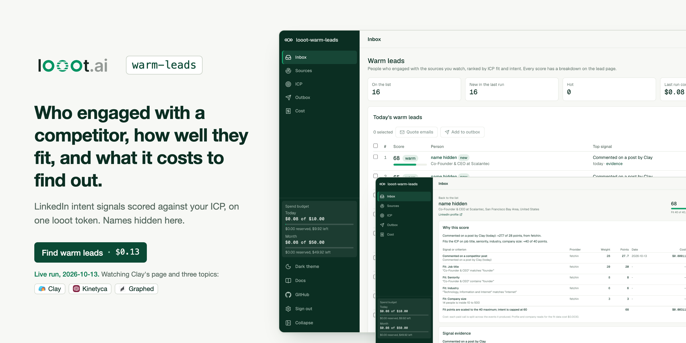
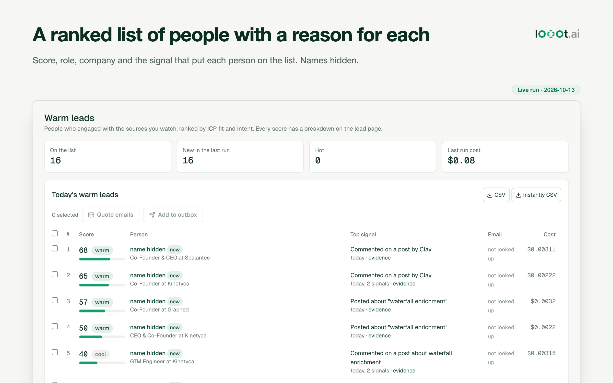
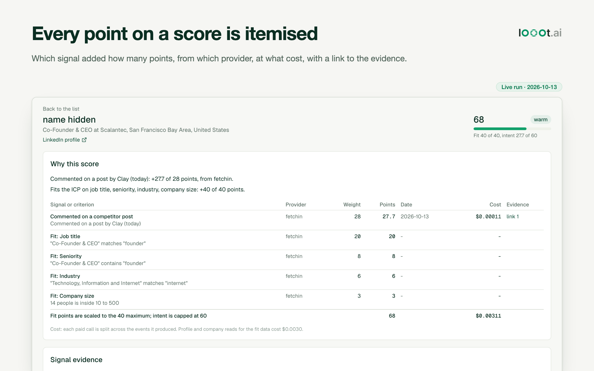
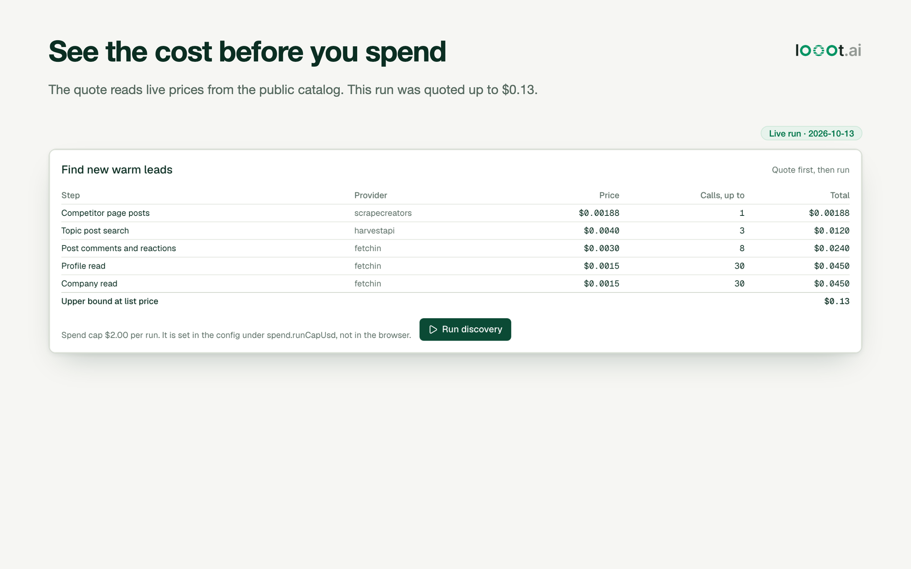
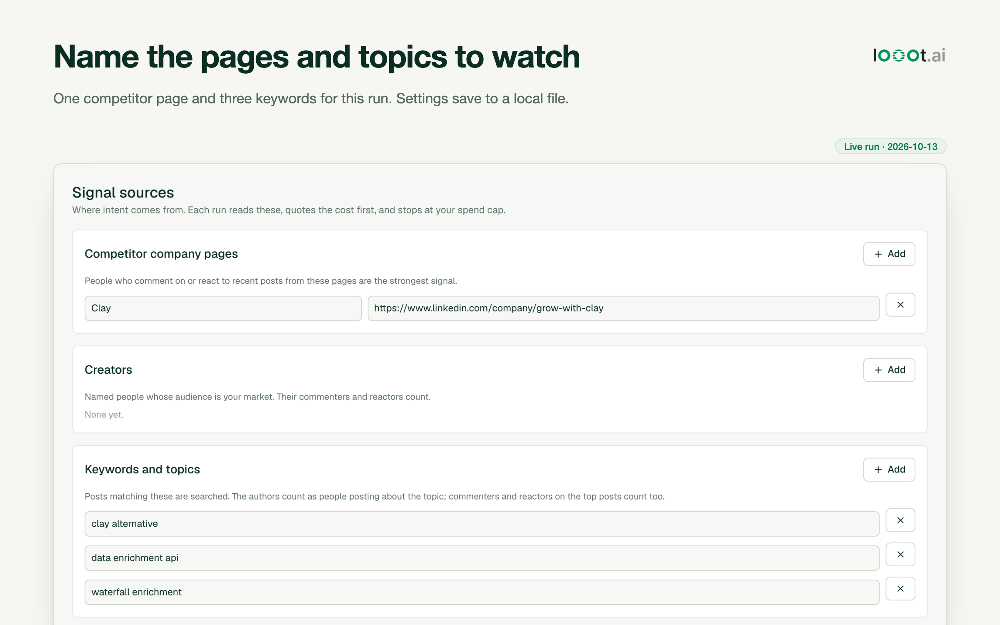
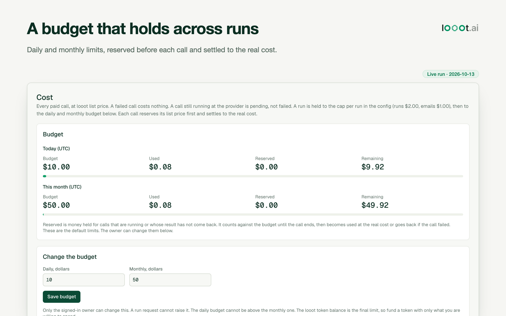
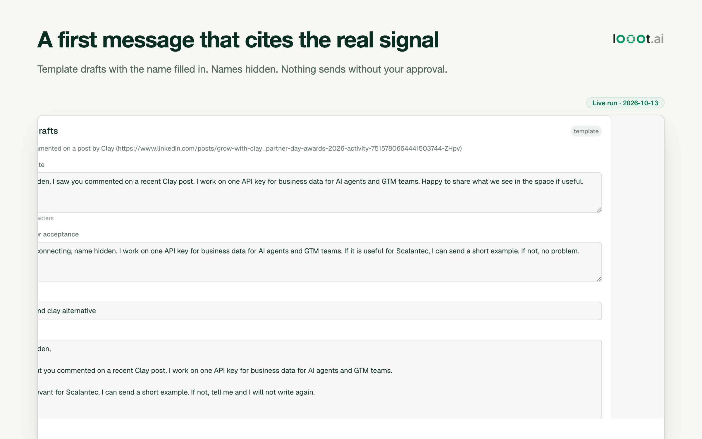
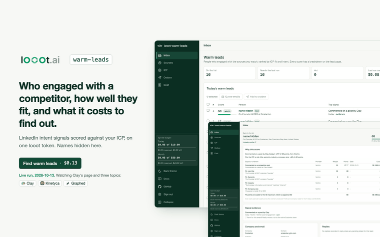
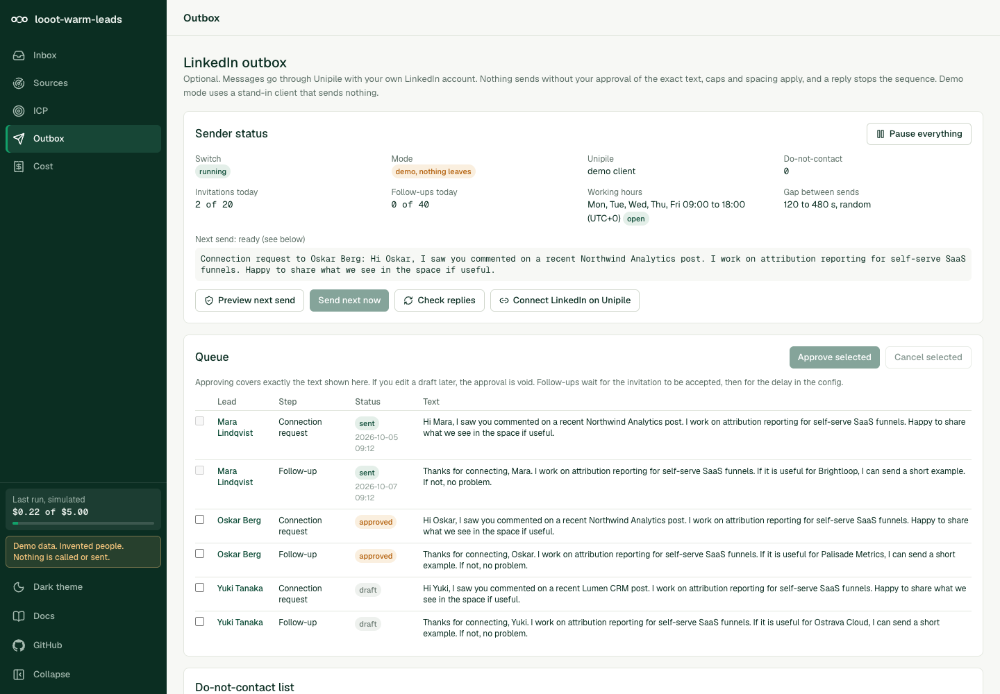

Logos and names belong to their owners. Public data from a live run on 2026-10-13. No affiliation.

# looot-warm-leads

> **Security notice.** Versions 0.1.4 and older had no admin sign-in. Anyone who could reach a deployed instance could start paid looot runs, send LinkedIn messages through Unipile when dry-run was off, erase or export leads, and read the lead CSV. If you run 0.1.4 or older on a reachable host, upgrade to 0.1.5 and set `WARM_ADMIN_PASSWORD`. See [Securing a deployment](#securing-a-deployment).

Warm B2B leads from LinkedIn intent signals, on one [looot](https://looot.ai) key. An open-source alternative to [Gojiberry](https://gojiberry.ai), which lists its Pro plan at $99 a month (read on 2026-10-10).

You name competitors, creators and topics. It finds the people who commented on or reacted to their posts, who posted about the topic, who started a new role, or who work at a company that is hiring or just raised money. It reads their profiles, scores each person against your ICP, and ranks a daily list. Every score shows which signal added how many points, which provider supplied it, what it cost, and a link to check it. You pick leads, see the cost of the email lookup first, and get a verified work email. It drafts a first message that refers to the real signal. Export to CSV or to an Instantly import file. Sending on LinkedIn is optional and goes through your own Unipile account, see below.


<table>
<tr>
<td width="50%"></td>
<td width="50%"></td>
</tr>
<tr>
<td></td>
<td></td>
</tr>
<tr>
<td></td>
<td></td>
</tr>
</table>

Every image comes from the running app on the data of the live run below and says "Live run · 2026-10-13". People's names are replaced with "name hidden" before each screenshot, and no email was looked up. The Sources page shows the config of the run, and the Cost page shows the real budget file.



The same walkthrough as MP4: [docs/media/demo.mp4](docs/media/demo.mp4).

## Live run: looot watching its own market

`examples/looot-market.json` points the app at looot's market. It reads the posts of Clay's LinkedIn page (`linkedin.com/company/grow-with-clay`) and searches posts for "clay alternative", "data enrichment api" and "waterfall enrichment". The ICP is heads of growth, GTM engineers and founders at B2B software companies with 10 to 500 people. The run on 2026-10-13 (UTC) used `limits` of 3 posts per source, engagement on 2 posts per source and profile reads for the best 30 people, with a cap of $0.20.

| | |
|---|---|
| Quote (upper bound) | $0.13 |
| Charged | $0.079 |
| Calls | 45, of which 43 were charged and 2 failed at $0 |
| People found | 89 |
| Profiles read | 30 |
| On the list | 16 (4 warm, 12 cool, 0 hot) |

What was good. The top four leads were founders or CEOs of small B2B firms, with a real signal each: two commented on a Clay partner post, two wrote a post about waterfall enrichment. Each score shows its points and links to the post.

What was bad.
- 9 of the 16 leads work at Clay. They commented on their own company's posts. The app does not drop people from the competitor you watch, so add the competitor's name to `icp.excludeTitles` or filter the list yourself.
- 2 of 8 engagement calls came back as a provider error. They were not charged. Their posts gave no commenters.
- Only 30 of 89 people were read. The other 59 never got a fit score, so the list is the best of a sample.
- Most reactions on Clay's page are undated, so they score at half decay.
- Company reads ran for 3 companies, not the 30 in the quote. The quote is an upper bound.
- No email was looked up in this run. Email finding is quoted and run separately.

The run shows real people, so every image hides names. The state file in `.looot-warm/` does hold them, and so does the CSV, so keep both private.

## What it is, and what it is not

It is a local tool: a Next.js app, a CLI and a daily GitHub Actions workflow on one engine. State is a JSON file in `.looot-warm/`. There is no hosted service and no database. The web UI has one admin password, set in the environment (see [Securing a deployment](#securing-a-deployment)). It is not a hosted outreach platform: it does not run campaigns for you, and it does not send email.

It does not log in to LinkedIn, does not use a LinkedIn session cookie, and does not automate a browser. The intent data comes from public-data providers through looot. The optional LinkedIn sending goes only through Unipile's hosted auth.

One live looot run was made. Nothing was run against a Unipile account. See [status](#status).

## What Gojiberry does, as read on 2026-10-10

Sources: gojiberry.ai home page and blog index, plus review summaries from Salesforge, HeyReach, G2 and others (several are from competitors, so treat them as direction, not fact). gojiberry.ai/pricing returned 404, so the price below is from the home page.

- Finds "warm leads" from "15+ buying and social signals" and filters them by your ICP. The home page names competitor engagement, people who follow your company, and people active in your space. Reviews add job changes, funding events and post interactions. It also mentions lookalikes.
- Scores leads against your ICP.
- Runs personalised outreach on email and social channels. You can choose full auto or approve each message before it sends. It drafts replies and keeps a unified inbox.
- Claims to learn what converts and to benchmark campaigns.
- Integrations: HubSpot, Pipedrive, an API and an MCP server.
- Price: Pro $99 a month, with 2 AI agents, up to 1,800 prospects contacted a month, a unified inbox, lead scoring, a Copilot mode, email waterfall enrichment from "15+ data providers" and live chat support. A Custom plan for teams of 3 or more has no public price. A free trial is advertised; its length is not stated.

## What you get here, and what you do not

| Gojiberry feature | Here |
|---|---|
| Competitor engagement | Yes. Commenters and reactors on recent posts from competitor company pages. |
| Active in your space | Yes. Authors, commenters and reactors on posts that match your keywords. |
| Creator and post engagement | Yes. Named creators, and specific post URLs. |
| Job changes | Yes, from the profile: a current role that started in the last N days. No separate paid call. |
| Hiring and funding triggers | Yes, optional. PredictLeads through looot, $0.01 per company. |
| ICP scoring | Yes, and each score is itemised. Weights are in `config/warm.config.json`. |
| Email enrichment | One finder and one verifier, with the quote first. Not a 15 provider waterfall. |
| First message per lead | Yes, from templates. An optional LLM rewrite is off unless you set three env vars. |
| Outreach | CSV and an Instantly import file need no extra account. LinkedIn sending is optional through Unipile. No email sending. |
| Follows your company | No. I found no endpoint in the looot catalog that lists a company page's followers. |
| Lookalike leads | No. Not built. |
| Autonomous agents and full auto sending | No, on purpose. Every send needs your approval of the exact text. |
| Learning from conversions, benchmarks | No. |
| AI-drafted replies, unified inbox | No. Replies from Unipile show on the lead page, you answer them in LinkedIn. |
| CRM sync | No. CSV only. |
| Hosted, 3 minute setup | No. You run it. |
| 15+ signals | 12 signal kinds from 7 sources, listed below. |

## What you need

- Node 22.13 or newer. Vitest 5 needs 22.12 and ESLint 10 needs 22.13 on the 22 line, so the old floor of Node 20 is too low for the tests and lint. The daily workflow uses Node 24 and the checks below ran on Node 24.18. The repo has no `engines` field or `.nvmrc`.
- npm, which comes with Node.
- For the demo, `--dry-run` and the tests, nothing else. No account, no token.
- For a real run, a looot account and an agent token.
  1. Sign up at https://looot.ai/auth/sign-up.
  2. Get a token. Run `npm i -g looot` then `looot login`, which opens a browser approval. Or open the looot web app, go to Settings, "Agent tokens" and create one. See https://docs.looot.ai/get-started/sign-in.
  3. With no browser (CI, a server), create the token in Settings, "Agent tokens", then `export LOOOT_TOKEN=...`.
  4. The token needs the scopes `runs.execute`, `catalog.read`, `runs.read` and `usage.read`.
  5. A run needs a funded balance. The minimum top-up is $5, and signing up adds no credit. See https://docs.looot.ai/money.
- Optional accounts, only if you use the feature. A [Unipile](https://www.unipile.com) account for LinkedIn sending (paid, see below). An Anthropic API key for the LLM rewrite of drafts. Nothing else. There is no Supabase and no database. Admin sign-in is one password you set in the environment.

## Try it in one minute

```bash
git clone https://github.com/loootai/looot-warm-leads.git
cd looot-warm-leads
npm ci --ignore-scripts
npm run demo            # web UI on http://localhost:3281
```

Open http://localhost:3281. The demo has no sign-in and shows a "Demo, no sign-in" badge. It refuses to start if `LOOOT_TOKEN` is set or a state file exists, unless you also set an admin password. It shows invented people and companies, makes no network call and needs no token or account. Stop it with Ctrl+C. The same engine from the CLI, writing reports to `./out`:

```bash
npm run warm -- run --demo
```

Demo mode runs the real engine with a stand-in for looot and for Unipile. Costs shown are list prices, booked as simulated spend.

## Run it with your own data

The CLI reads variables from the shell environment, not from a file. `npm run dev` also loads `.env.local`, which Next.js does on its own, so for the web UI you can copy the template. Its optional lines are commented out, because an empty value would override the default:

```bash
cp .env.example .env.local     # web UI only. For the CLI, export the variables instead.
```

Every environment variable the code reads:

| Name | Required | What it does | Where to get it |
| --- | --- | --- | --- |
| `LOOOT_TOKEN` | For a real run or an email lookup. Not for `--demo` or `--dry-run`. | Agent token sent to the looot API. | See "What you need". |
| `WARM_ADMIN_PASSWORD` | Required outside the demo | Admin password, 12 characters or more. Without it the admin pages and admin API are closed, live sending cannot be turned on, and `/login` shows a setup page. | Choose one. |
| `WARM_ADMIN_PASSWORD_HASH` | Alternative | `scrypt$salt$key` instead of the plain password. Wins if both are set. | `npm run hash-password -- 'your password'` |
| `WARM_SESSION_SECRET` | No | Key that signs session cookies. Default: derived from the password, so a new password signs everyone out. | Leave unset, or a long random string. |
| `WARM_COOKIE_SECURE` | No | Set `0` to drop the Secure flag in production, only for plain-http testing. | Leave unset. |
| `LOOOT_API_URL` | No | Overrides the looot API base URL. Default `https://api.looot.ai`. | Leave unset. |
| `WARM_DIR` | No | Folder for saved state. Default `.looot-warm`. | Your choice. |
| `WARM_CONFIG` | No | Config file to use. Same as `--config`. Default `$WARM_DIR/config.json`, then `config/warm.config.json`. | Your choice. |
| `WARM_DEMO` | No | `1` runs on sample data with no network. Same as `--demo`. `npm run demo` sets it. | Set by the script. |
| `UNIPILE_DSN` | For LinkedIn sending | Your Unipile API host, for example `api1.unipile.com:13111`. | Unipile dashboard. |
| `UNIPILE_API_KEY` | For LinkedIn sending | Sent as the `X-API-KEY` header. | Unipile dashboard. |
| `UNIPILE_ACCOUNT_ID` | No | The connected LinkedIn account. If unset, the account id from the Unipile callback is used. | Unipile dashboard. |
| `UNIPILE_WEBHOOK_SECRET` | For the webhook | The webhook accepts a request only if its `Unipile-Auth` header equals this value, compared in constant time. Without it the webhook answers 401 to everything. | Make up a long random string. |
| `WARM_LLM` | No | `anthropic` switches on the LLM rewrite of drafts. All three LLM variables must be set. | You set it. |
| `ANTHROPIC_API_KEY` | With `WARM_LLM` | Key for the Anthropic API. | Anthropic console. |
| `WARM_LLM_MODEL` | With `WARM_LLM` | Model name sent to the Anthropic API. | Anthropic docs. |

Set your sources. Copy the shape from `examples/sources.example.json` into `config/warm.config.json` (or use the Sources and ICP pages in the web UI, which save to `.looot-warm/config.json`). A config file only has to name what it changes; the rest comes from the defaults. Check it:

```
$ npm run warm -- config
Config is valid. 0 competitors, 0 creators, 0 keywords, 0 watched posts. Triggers: newRole.
```

The quote comes first. A dry run needs no token. It reads current prices from the free public catalog, so it needs network access. With the example file this is the real output:

```
$ npm run warm -- run --dry-run --config examples/sources.example.json
  Competitor page posts          scrapecreators linkedin.company.posts      $0.00188 x    1 =  $0.00188
  Creator posts                  harvestapi     linkedin.person.posts        $0.0040 x    1 =   $0.0040
  Topic post search              harvestapi     linkedin.post.search         $0.0040 x    1 =   $0.0040
  Post comments and reactions    fetchin        linkedin.post.engagement     $0.0030 x    6 =   $0.0180
  Profile read                   fetchin        linkedin.person.profile      $0.0015 x   60 =   $0.0900
  Company read                   fetchin        linkedin.company.profile     $0.0015 x   60 =   $0.0900
  Upper bound                                                                                   $0.21
  Prices: read from the public looot catalog
Dry run. No call was made.
```

Then the real run:

```bash
export LOOOT_TOKEN=...
npm run warm -- run --max-spend 1 --since-last   # writes ./out/warm-<date>.{json,csv,md} and new-<date>.{md,csv}
npm run warm -- leads --limit 20
npm run warm -- email --top 5 --dry-run          # quote for finding and verifying emails
npm run warm -- email --top 5 --max-spend 0.5
npm run warm -- export --format instantly        # only leads with a verified email
npm run dev                                      # the web UI on your own data, http://localhost:3000
```

Without a token a real run prints `LOOOT_TOKEN is not set. Use --dry-run to see the cost, or --demo for sample data.` and exits with code 2. Other exit codes are 0 for done and 1 for an error.

State (leads, outbox, do-not-contact hashes) is the JSON file `.looot-warm/state.json`. Reports go to `out/`, or to `--out <dir>`.

## Spending

Four limits stand between a request and a charge, checked in this order: the quote, the cap per run, the period budget, then the call. The paid paths are the discovery run (`run`) and the email lookup (`emailRun`, `warm email`). Both go through the same meter.

- Every paid action shows its quote first, in the Run panel, in the email quote and with `--dry-run`.
- In the web UI the caps come from the config, `spend.runCapUsd` (default $2) and `spend.emailCapUsd` (default $1). The browser cannot raise them, and a cap in a request is ignored. At most 6 paid actions per session every 10 minutes. The CLI takes `--max-spend`, default $2 for a run and $1 for emails. Before each call the list price is reserved against the cap, so spend cannot pass it. A quote above the cap is refused (exit code 2) unless you pass `--partial`.
- A typical run is $0.25 at most for 3 competitor pages, 2 creators and 3 keywords with only the new-role trigger, and $0.65 at most with hiring and funding triggers. See [what a typical run costs](#what-a-typical-run-costs). Emails cost $0.0054 per lead at most and are always quoted separately.
- The period budget caps all runs together: a daily and a monthly amount (UTC), $10 and $50 until you change them. The owner changes them on the Cost page of the web UI, or sets the starting values with `WARM_DAILY_USD` and `WARM_MONTHLY_USD`. A request to `/api/action` cannot carry a budget or a cap: any such field in it is ignored. A run whose quote is above what is left is refused (exit code 2 on the CLI) unless you pass `--partial`, which runs until the budget is reached. An email lookup above what is left is always refused.
- Before each paid call the app reserves its list price in `budget.json` (in `WARM_DIR`), under a lock file, and refuses the call if used plus reserved plus the price would pass the daily or the monthly budget. Two requests started together cannot both pass. When the call ends the reservation becomes the real charge. A failed call releases it. A call still running at looot (`pending`) keeps its reservation: it is never recorded as failed at $0 and the budget is not handed back early.
- The next run or email lookup reads every pending call back with `GET /v1/runs/{id}` and settles the ones that ended, to their real cost. If looot cannot be reached, or the app died before it got a run id, the reservation stays for 24 hours and is then released. A network error mid-call is treated the same way, because the call may have been accepted.
- The sidebar and the Cost page show used, reserved and remaining for today and this month. At the budget the call is skipped and the run says which limit it hit.
- Every call has a stable key: the endpoint, the normalised input (trimmed, lowercased, keys sorted) and the refresh period. The key has no date or clock time in it. The refresh period is the whole number `floor(time / 24 hours)`, so a repeated request inside the period gets the same key, is answered from the stored result in `budget.json` with no call and no reservation, and is never charged twice. A new period is a deliberate fresh request with its own key, because LinkedIn posts and their commenters change daily. Email lookups use a key made of the lead and the step with no period, so a lead is looked up once. If a stored result is missing, looot replays the same key without charging again.
- A run still in progress when waiting stops is "pending", never "failed at $0". It is counted separately and settled by the next run.
- A failed call is not charged. A 401 or 402 from looot stops all later calls in the run.
- The looot token balance is the final limit. Fund a dedicated token with only what you are willing to spend, and keep the budget below it.

The budget lives in a file, so run one instance on a disk that persists. Several instances, or a serverless host with a throwaway disk, do not share it.

## Securing a deployment

Versions 0.1.4 and older had no admin authentication. From 0.1.5 every route is either public on purpose or admin, and the admin routes are closed unless you set a password.

### What is public and what is admin

Pages and routes were listed from `src/app` and classified. A test reads the folder and fails if a route is missing from `src/lib/auth/routes.ts` or if an admin route does not call the gate.

| Kind | Count | Routes |
|---|---|---|
| Public | 5 | `/login`, `/api/auth/login`, `/api/auth/logout`, `/api/health`, `/api/unipile/webhook` |
| Admin pages | 6 | `/` (inbox), `/leads/[id]`, `/sources`, `/icp`, `/outbox`, `/cost` |
| Admin API | 3 | `/api/action` (every paid run, queue, approve, send, erase, purge, config and the live-send switch), `/api/budget` (read, and change the period budget), `/api/export` (the lead CSV) |

Any path not listed is treated as admin. The webhook is public because Unipile has to reach it. It answers 401 unless the `Unipile-Auth` header equals `UNIPILE_WEBHOOK_SECRET`, compared in constant time, and 401 to everything when the secret is not set.

### How it works

- Set `WARM_ADMIN_PASSWORD` (12 characters or more) or `WARM_ADMIN_PASSWORD_HASH` (from `npm run hash-password -- 'your password'`). Without one, admin routes answer 503, admin pages go to `/login`, and `/login` says what to set.
- `src/proxy.ts` checks every request. Each admin page, the root layout and each admin route handler checks again with the same function, so a path the matcher misses is still closed.
- Sign-in compares the password in constant time. A session is a signed token in an httpOnly, SameSite=Lax cookie, Secure in production, valid for 8 hours. 5 wrong passwords from one address lock that address for 15 minutes. 40 wrong passwords from anywhere lock sign-in for everyone for 15 minutes.
- Every state-changing admin request needs a same-origin `Origin` header and the per-session token in `x-warm-csrf`. The layout puts the token in a meta tag and the app's own calls send it.
- Sending a LinkedIn message needs the session, the CSRF token, the id of the next item, and the hash of the text you reviewed. The server checks them against the outbox before it calls Unipile.
- Live sending cannot be switched on without an admin password. The switch is an admin action and is recorded in the audit log with the session that did it.
- Spend caps come from `spend.runCapUsd` and `spend.emailCapUsd` in the config. A run still shows its quote first and is refused when the quote is above the cap. There is a limit of 6 paid actions per session every 10 minutes.
- The period budget (`PUT /api/budget`) is changed only by the signed-in owner, with the CSRF token. A run cannot raise it. See [Spending](#spending). The looot token balance is the final limit, so give the app a token funded with only what you are willing to spend.
- Admin responses carry `Cache-Control: no-store`. All responses carry a Content-Security-Policy (`frame-ancestors 'none'`), `X-Frame-Options: DENY`, `X-Content-Type-Options: nosniff` and `Referrer-Policy: no-referrer`. The CSP allows inline scripts because Next.js needs them.
- The demo (`npm run demo`) has no sign-in and shows a "Demo, no sign-in" badge. It refuses to start next to a `LOOOT_TOKEN` or a state file unless an admin password is set.

### Set it up

```bash
export WARM_ADMIN_PASSWORD='a password of 12 or more characters'
# or keep it out of the environment as plain text:
npm run hash-password -- 'a password of 12 or more characters'   # prints WARM_ADMIN_PASSWORD_HASH=...
npm run build && npm start
```

A shared password is the floor. For anything people other than you can reach, put the app behind a VPN, a private network or an identity-aware proxy (Cloudflare Access, Tailscale, Google IAP, oauth2-proxy), and leave only the public routes in the table above reachable from the internet. Keep the app's password on as well. The rate limits are in memory, so behind several instances also limit at the proxy.

### What changes when you upgrade

- The web UI asks for the password. Set `WARM_ADMIN_PASSWORD` before you start 0.1.5, or the admin pages stay closed.
- 0.1.6 adds a daily and monthly budget in `budget.json` next to `state.json`, $10 and $50 by default. A run or email lookup above what is left is refused. Raise it on the Cost page, or set `WARM_DAILY_USD` and `WARM_MONTHLY_USD`. Run one instance on a persistent disk.
- The config file has a new `spend` block. The run and email caps in the web UI come from it, and the cap box on the Inbox page is gone.
- `outbox.dryRun: false` in the config now has no effect without an admin password. That applies to the CLI too: `warm outbox tick --live` needs `WARM_ADMIN_PASSWORD` in the environment.
- Changing `outbox.dryRun` through the config save no longer works. Use the live-send switch on the Outbox page.

### Not covered

One admin, no per-user accounts or roles. The audit log records the live-send switch and live sends, not every sign-in. The CLI (`npm run warm`) has no sign-in: it runs as you on your machine and reads the same state file.

## Deploy

There is no `vercel.json` and no Supabase. The app keeps its state in the JSON file `.looot-warm/state.json` (`WARM_DIR`). Vercel's filesystem does not persist between requests, so a Vercel deploy would lose your leads and outbox. Run the web UI on a machine with a disk: `npm run build && npm start`, with `LOOOT_TOKEN`, `WARM_ADMIN_PASSWORD` (and the Unipile variables, if you use them) in the environment, and serve it over HTTPS. Without `WARM_ADMIN_PASSWORD` the app serves no admin page. Read [Securing a deployment](#securing-a-deployment) first.

### Daily run on GitHub Actions

`.github/workflows/daily.yml` runs every day at 06:17 UTC and on demand. It installs without install scripts, restores the list from the last run, prints the free quote, and, only if a `LOOOT_TOKEN` repository secret exists, runs `warm run --since-last`, writes the new warm leads to the job summary, saves the list for the next run, and uploads the reports for 7 days. Without the secret it spends nothing and says why. It never sends anything to LinkedIn or by email. The workflow passes `actionlint`.

1. Fork or copy the repo. Put your sources and ICP in `config/warm.config.json` and commit it. The scheduled run uses the committed file, and with no sources the run step stops with "No signal sources are set".
2. Add the repository secret `LOOOT_TOKEN` under Settings, Secrets and variables, Actions.
3. Run it once. Open the Actions tab, pick "daily-warm-leads", click "Run workflow" and set the spend cap (default 1 dollar). Or from a terminal, `gh workflow run daily.yml -f max_spend=1`.
4. Read the new leads in the job summary, or download the `warm-leads` artifact. The list of the previous run comes back through the Actions cache, so "new" means new since the last scheduled run.

The only variable the workflow sets is `WARM_DIR=.looot-warm`. The reports contain personal data, so use a private repository.

## How a run works

1. **Sources.** For each competitor page, creator and keyword it lists recent posts. Posts older than `limits.lookbackDays` are dropped.
2. **Engagers.** For the top posts per source (`limits.engagementPostsPerSource`) it reads comments and reactions. For keywords, the authors of matching posts are people posting about the topic.
3. **Pick who to read.** Candidates are ranked by intent so far and by the ICP title in their headline. Titles in `icp.excludeTitles` are dropped. Only the best `limits.maxEnrich` get a profile read. People already read in the last 30 days are not read again.
4. **Profile and company.** Title, current company, role start date and location from the profile. Industry, headcount and domain from the company page.
5. **Triggers.** New role comes from step 4 at no extra cost. Hiring and funding are looked up only for the best `limits.maxTriggerCompanies` companies.
6. **Score and rank.** Fit plus intent, 0 to 100. Leads below `scoring.listMinScore` stay in the file but not on the list. A lead is "new" when it was not on the list in the previous run.

### Scoring

Score = fit points + intent points. Fit is at most `scoring.fitMax` (40), intent at most `scoring.intentMax` (60).

- Fit has up to five checks: title, seniority, industry, location, company size. A check your ICP does not set is left out and the rest are scaled to the fit maximum. A check whose data is missing scores 0 and says so ("no industry in the data"). Nothing is guessed.
- Each intent signal has a weight (its maximum points) and a half-life in days. Points = weight x decay of the newest event, where decay is 0.5 at one half-life. An undated event counts 0.5. Extra events of the same signal add `scoring.repeatBonus` (0.2) of the weight each, up to three. The sum is capped at the intent maximum. When leads tie at the cap, the uncapped sum orders them.
- Bands: hot from `hotAt` (70), warm from `warmAt` (45), otherwise cool.

The breakdown on a lead page lists, for every line: the signal or criterion, the provider, the weight, the points, the date, the cost and links to the evidence. The cost of a call is split across the events it produced. Profile and company reads for fit data are shown on their own line under the table.

## Signals, looot jobs and prices

Prices are per call at looot list price, read from the public catalog on 2026-10-10. A live run reads the current price of every endpoint before it starts, shows it in the quote, and refuses a call whose price it cannot read. The app pins one endpoint per step, so the quoted price is the price charged. All response parsing is written from each endpoint's documented parameters and description, see [status](#status).

| Used for | looot job | Endpoint | Per call |
|---|---|---|---|
| Posts of a competitor page | `linkedin.company.posts` | `scrapecreators-linkedin-company-posts` | $0.00188 |
| Posts of a creator | `linkedin.person.posts` | `harvestapi-profile-posts` | $0.004 |
| Posts matching a keyword | `linkedin.post.search` | `harvestapi-post-search` | $0.004 |
| Comments and reactions on a post | `linkedin.post.engagement` | `fetchin-post-engagement` | $0.003 |
| Profile (title, role start, location) | `linkedin.person.profile` | `fetchin-profile` | $0.0015 |
| Company (industry, headcount, site) | `linkedin.company.profile` | `fetchin-company` | $0.0015 |
| Open roles, optional | `jobs.company` | `predictleads-companies-job-openings` | $0.01 |
| Funding events, optional | `company.funding` | `predictleads-companies-financing-events` | $0.01 |
| Work email find | `people.email.find` | `anysite-api-linkedin-user-email` | $0.003598 |
| Email verify | `people.email.verify` | `millionverifier-verify` | $0.00178 |

You can swap the email endpoints in `endpoints.emailFind` and `endpoints.emailVerify`. Other looot catalog entries fit the same jobs, for example `people.job.changes` ($0.108 a call) for a dedicated job-change feed, which this version does not use because the profile already carries the role start date.

### Signal kinds

| Signal | Source | Default weight, half-life |
|---|---|---|
| Commented on a competitor post | competitor pages | 28, 21 days |
| Reacted to a competitor post | competitor pages | 14, 14 days |
| Commented on a creator post | creators | 16, 21 days |
| Reacted to a creator post | creators | 7, 14 days |
| Posted about the topic | keywords | 20, 21 days |
| Commented on a topic post | keywords | 12, 21 days |
| Reacted to a topic post | keywords | 6, 14 days |
| Commented on a watched post | post URLs | 16, 21 days |
| Reacted to a watched post | post URLs | 7, 14 days |
| Started a new role | profile | 18, 60 days |
| Company is hiring a related role | PredictLeads | 10, 45 days |
| Company raised funding | PredictLeads | 10, 120 days |

### What a typical run costs

For 3 competitor pages, 2 creators and 3 keywords with the defaults (2 top posts per source, up to 60 profiles read), at list price, as an upper bound:

| Triggers | Upper bound per run |
|---|---|
| New role only (the default) | $0.25 |
| New role, hiring and funding for up to 20 companies | $0.65 |

The run usually costs less: it reads fewer profiles when the sources return fewer people, and people already read are not read again. A failed call costs nothing. Emails cost $0.0054 per lead at most ($0.003598 to find, $0.00178 to verify, the verify only when an address came back). Email lookups are separate and always quoted first. `npm run warm -- run --dry-run` prints the exact table for your config.

## Messages, export and Instantly

Drafts come from the templates in `config/warm.config.json` under `messages`, chosen by the strongest signal and filled with the person's first name, company, the signal and the one-line offer you set under `sender`. A draft that still has an unfilled placeholder, or a connection note over `messages.noteMax` (300), carries a warning. The signal the draft refers to is shown above the text.

An optional LLM rewrite runs only when `WARM_LLM=anthropic`, `ANTHROPIC_API_KEY` and `WARM_LLM_MODEL` are all set. It sends the first name, title, company and one signal sentence to the Anthropic API and nothing else. If it fails or returns a note that is too long, the template draft is kept.

`warm export --format csv` writes the ranked list. `--format instantly` writes `email,first_name,last_name,company_name,website,personalization,job_title,linkedin_url,signal,score` for leads whose email was verified deliverable. `personalization` is the first line of the email draft. The extra columns come in as custom variables when you map them in Instantly's import screen (written from Instantly's docs, not tested against an Instantly account). Cells that start with `=`, `+`, `-` or `@` get a leading quote so a spreadsheet does not run them.

## LinkedIn sending through Unipile (optional, off by default)

Sending is not part of looot. It goes through [Unipile](https://www.unipile.com), a paid third-party API, with your own LinkedIn account. looot's catalog has no Unipile entry (checked 2026-10-10), so this app calls Unipile directly with your own key. Without a Unipile account, use the CSV and Instantly exports.

Unipile's public price, read on 2026-10-10 on unipile.com/pricing-api: EUR 49 a month minimum (USD 55) for up to 10 connected accounts, then EUR 5 per account from the 11th, billed after the fact on the peak number of linked accounts, with a 7 day free trial. The page's own FAQ example disagrees with its table in one place, so check it yourself.

### Unipile setup

Six steps. Each one is confirmed in the code (`src/sender/unipile.ts`, `src/cli/cli.ts`, `src/app/api/unipile/webhook/route.ts`). None has run against a live Unipile account.

1. Create a Unipile account and note the DSN (your API host, with its port) and the API key from the Unipile dashboard.
2. Export `UNIPILE_DSN` and `UNIPILE_API_KEY`, or put them in `.env.local` for the web UI. The sender stays off until both are set.
3. Connect your LinkedIn account. Run `npm run warm -- connect` (add `--success-url <url>` to choose where Unipile sends you afterwards), or use "Connect LinkedIn on Unipile" on the Outbox page. Either prints a hosted auth link. Open it and sign in on Unipile's page.
4. Tell the app which account to use. Export `UNIPILE_ACCOUNT_ID` with the account id shown in your Unipile dashboard. The connect commands do not register a callback URL, so the id does not arrive on its own.
5. Replies and accepted invitations, two ways. Either run `npm run warm -- outbox sync` a few times a day at uneven times, or register webhooks. For webhooks, set `UNIPILE_WEBHOOK_SECRET` to a long random string, make the app reachable at a public HTTPS URL, and create two Unipile webhooks, one with source `messaging` (new messages) and one with source `users` (new relations). Both use `request_url` `https://<your-host>/api/unipile/webhook` and the header `Unipile-Auth` set to your secret. The app does not create them for you. The request Unipile expects, as the client in `src/sender/unipile.ts` builds it:

   ```bash
   curl -X POST "https://$UNIPILE_DSN/api/v1/webhooks" \
     -H "X-API-KEY: $UNIPILE_API_KEY" -H "Content-Type: application/json" \
     -d '{"source":"messaging","request_url":"https://<your-host>/api/unipile/webhook","name":"warm-leads-messages","headers":[{"key":"Content-Type","value":"application/json"},{"key":"Unipile-Auth","value":"<your secret>"}]}'
   ```

   Repeat with `"source":"users"` and another name. If `UNIPILE_DSN` already starts with `https://`, drop the `https://` in front of it.
6. Go live, only when you want to. Review the drafts in the Outbox, approve them, set `WARM_ADMIN_PASSWORD`, press "Turn on live sending" on the Outbox page (this sets `outbox.dryRun` to `false` and writes an audit entry), then send one at a time with the "Send next now" button or `npm run warm -- outbox tick --live`. Until then the sender only prints what it would send.

**Sending volume is your responsibility under LinkedIn's terms.** LinkedIn limits automated activity and can restrict accounts that exceed it or look automated. Unipile publishes conservative limits (about 80 to 100 invitations a day and 200 a week on a paid account, about 100 profile reads a day, and random spacing during working hours). This app's defaults are lower, but they are only defaults: you set the numbers, and you decide what is acceptable for your account.

What the sender does:

- You pick leads in the inbox and choose Add to outbox. That creates two drafts per lead: a connection request with a note, and a follow-up message for after acceptance. Nothing is approved and nothing sends.
- You review the exact text in the Outbox and approve it per item or per reviewed batch. An approval is tied to a hash of the text you saw. Edit the text afterwards and the approval is void. A batch approval of text that changed since you looked is refused.
- The follow-up waits until the invitation is accepted (Unipile's `new_relation` webhook, or a slow profile check), then for `outbox.followUpDelayHours` plus up to two hours of jitter.
- Caps in `config/warm.config.json`: `dailyInvites` 20, `dailyMessages` 40 (follow-ups), `dailyProfileChecks` 20. Random gap of `minGapSeconds` to `maxGapSeconds` (120 to 480) after every send. A working-hours window (Monday to Friday, 09:00 to 18:00 at the UTC offset you set). A global pause switch. A do-not-contact list of hashes (LinkedIn URL, email or company domain). One send per tick.
- A reply stops the sequence: every pending step for that lead is cancelled, and the reply shows on the lead page. Replies arrive by webhook (`/api/unipile/webhook`, which accepts a request only when its `Unipile-Auth` header equals `UNIPILE_WEBHOOK_SECRET`) or by `warm outbox sync`.
- Sends are idempotent. The item is saved as "sending" before the network call. A definite refusal (HTTP 4xx) is "failed". A rate limit (429) puts the item back and pauses the queue for an hour. An answer the app cannot be sure about (network error, 5xx) becomes "unknown" and is never retried by the app, because the message may have gone out. You check LinkedIn and mark it sent or retry by hand. A second Add to outbox for a lead whose step already went out is refused.
- `outbox.dryRun` is `true` by default. In dry-run, and without `--live`, `warm outbox tick` only prints what would be sent. Live sending needs all of: `WARM_ADMIN_PASSWORD` (or the hash), `UNIPILE_DSN`, `UNIPILE_API_KEY`, a connected account, `outbox.dryRun` set to `false`, and `--live` (or the Send next now button). With no admin password the app reads `outbox.dryRun` as `true` whatever the config file says, and refuses to save `false`. In the web UI the send names the item and the hash of the text you reviewed; the server refuses it if the item is not the next one, or if the text no longer matches the approved hash. The switch and every live send are written to an audit log, shown on the Outbox page and stored in the state file under `audit`.
- The account is connected only through Unipile's hosted auth link (`warm connect`, or the button on the Outbox page). This app never sees a LinkedIn password or cookie.

Unipile endpoints used, from developer.unipile.com (read 2026-10-10): `POST /api/v1/hosted/accounts/link`, `GET /api/v1/users/{identifier}`, `POST /api/v1/users/invite`, `POST /api/v1/chats`, `GET /api/v1/chats/{chat_id}/messages`, `POST /api/v1/webhooks`. The header is `X-API-KEY`. `POST /api/v1/chats/{chat_id}/messages` is wrapped but the queue does not use it.

Left out because the docs do not say enough: webhook payload signing beyond the custom header, any Unipile idempotency header, and retry-after details on 429. The app handles those cases conservatively instead of guessing.



## Privacy

This tool stores personal data about people who have not asked you to. Keep it small and have a lawful basis before you contact anyone.

- **What is stored:** name, LinkedIn profile URL, headline, current title and company, location text, the signal events (with a snippet of at most 160 characters of a comment, and the post URL), a work email if you looked one up, your drafts, and any reply. Not stored: full profile history, photos, connections, or anything outside what the lead list needs.
- **Lawful basis.** For B2B outreach this is usually legitimate interest (GDPR Article 6(1)(f)), which needs a balancing test, a clear notice at first contact and an easy opt-out. Cold email and automated LinkedIn messages can need consent in some countries (ePrivacy rules, PECR in the UK, CASL in Canada). This is not legal advice. Check your own situation.
- **Deletion.** `npm run warm -- forget <linkedin url or email>` erases the lead and its outbox items and keeps only a hash on a suppression list, so later runs do not add the person back. The Erase button on a lead page does the same.
- **Do not contact.** `warm dnc <url, email or domain>` stores a hash only and cancels pending messages for that person.
- **Retention.** `privacy.retentionDays` (90) is used by `npm run warm -- purge`, which deletes leads not seen for that long. A purged lead that you had contacted leaves its hash on the suppression list so you cannot message them twice by accident. Run `purge` on a schedule if you want retention enforced.
- **Where data goes.** looot and its providers receive the LinkedIn URLs and search terms you query. Unipile receives your messages if you turn sending on. The optional LLM step sends one lead's first name, title, company and signal sentence to Anthropic.
- **GitHub Actions.** The daily workflow keeps its state in the Actions cache and the reports in a 7 day artifact, both private to the repository. Use a private repository, or delete the cache after each run.
- **Demo data** is invented. No real person or company is in this repository.

## Troubleshooting

| What you see | What it means | What to do |
| --- | --- | --- |
| `LOOOT_TOKEN is not set. Use --dry-run to see the cost, or --demo for sample data.` (exit 2). For emails, `LOOOT_TOKEN is not set.` | No token in the environment of the CLI. | `export LOOOT_TOKEN=...` in the same shell. The CLI does not read `.env.local`. |
| `Stopped: <message>` in the run summary, or a failed call with `looot returned HTTP 401` | looot rejected the token. A 401 stops the rest of the run. | Create a new token with the four scopes in "What you need". |
| `Stopped: <message>`, or `looot returned HTTP 402` | The balance may be too low. The app shows whatever looot returns and stops the run on a 402. | Top up at https://docs.looot.ai/money (minimum $5) and run again. Finished calls replay free the same day. |
| A call counted under "failed" with the run's error message, or `blocked` / `stopped` | looot blocked or stopped the run. | Open the run in the looot web app and read the reason. |
| `Run <runId> is <status>.` and "N pending" in the summary | The provider has not finished. Pending is not a failure. | Run the same command again the same day. The finished call is collected without a second charge. |
| `A profile came back in a shape the parser does not know (<url>).` | The profile parser did not recognise the response. | Open an issue with the raw response (see below). |
| `The sources returned no people. Check the source URLs and keywords.` | Discovery found nothing. It can also mean a post-list or engagement response had a shape the parser skipped, because a parse that finds no rows is reported as "no data", not as a failure. | Check the URLs. If they are right, open an issue with the raw response. |
| `No signal sources are set. Add a competitor, creator, keyword or post first.` | The config has no sources. | Fill `sources` in the config. See `examples/sources.example.json`. |
| `The quote ($0.64) is above the cap ($0.50). Raise the cap, lower limits in the config, or pass --partial to run until the cap.` | The quote is above `--max-spend`. | Raise the cap, lower `limits`, or pass `--partial`. |
| `Live prices could not be read from the public catalog, so no call was made. Check your network and try again.` | The free catalog was not reachable. | Check your network. |
| `Set UNIPILE_DSN and UNIPILE_API_KEY first. You need your own Unipile account.` | `warm connect` ran without the Unipile variables. | Follow "Unipile setup". |
| `No Unipile account is connected.` | `outbox sync` found no account id. | Set `UNIPILE_ACCOUNT_ID`. |
| Unipile webhook gets HTTP 401 with `{"ok":false}` | `UNIPILE_WEBHOOK_SECRET` is unset, or the `Unipile-Auth` header differs from it. | Set the secret and use the same value in the webhook header. |

### How to file an issue

Open an issue at https://github.com/loootai/looot-warm-leads/issues with the run id (printed as `Run <runId>` for pending calls and shown in the looot run list), the command you used, and the raw response body with secrets removed.

## Status

- One paid looot run was made on 2026-10-13, see [Live run](#live-run-looot-watching-its-own-market). The post search, company posts, engagement and profile parsers worked on real responses. The company, job, funding, email and verifier parsers have not met a real response yet. A parse that finds nothing is reported as no data, not as a failure, so check the first real run by eye.
- **No Unipile call was made.** There was no Unipile account. The client is tested against mocked HTTP built from Unipile's public docs, not against the service. The hosted auth callback, the webhook payloads and the chat flow are unverified against a live account.
- **No Instantly import was tried.** The column format follows the field names in the `looot-instantly` repo and Instantly's documentation.
- The web UI was exercised in demo mode and in headless Chrome screenshots. The live paths (real looot token, real Unipile) were not clicked through.
- If a parser fails on a real response, open an issue with the raw response body (secrets removed).
- Engagement data on LinkedIn is incomplete: providers return a sample of commenters and reactors, not all of them, and reaction dates are the post's date when the provider gives none.

## Install for agents

```bash
git clone https://github.com/loootai/looot-warm-leads.git && cd looot-warm-leads && npm ci --ignore-scripts
npm run warm -- run --dry-run        # show the user this quote first
npm run warm -- run --max-spend 1    # needs LOOOT_TOKEN; exit 2 means refused
npm run warm -- leads --new
```

[llms.txt](llms.txt) describes the files and rules for agents. A Claude Code skill is in [skills/looot-warm-leads/SKILL.md](skills/looot-warm-leads/SKILL.md): copy the folder to `~/.claude/skills/` or to a project's `.claude/skills/`. An agent must quote first, must not raise the cap without the user's word, must never approve or send a LinkedIn message for the user, and must say that no paid run has been verified against real provider responses.

## Configuration

`config/warm.config.json` holds everything you tune: the ICP, sources, triggers, every signal weight and half-life, the fit weights, the band thresholds, limits per run, the email endpoints, your sender text, the message templates, the outbox caps and the retention period. The web app saves edits to `.looot-warm/config.json`, which wins over the shipped file. `WARM_CONFIG=path` or `--config path` picks another file.

Environment variables are listed in [Run it with your own data](#run-it-with-your-own-data) and in `.env.example`. The CLI does not read `.env` files; export them in your shell. The web UI loads `.env.local`.

## Develop

```bash
npm test            # vitest, all HTTP mocked
npm run typecheck
npm run lint
npm run build
npm run leak-scan   # secrets, private hosts, personal emails; also runs as a pre-commit hook after `git config core.hooksPath .githooks`
```

Layout: `src/engine` (looot client, meter, discovery, scoring, drafts, exports, state), `src/sender` (Unipile client and the outbox), `src/server` (service layer shared by the CLI and the API routes), `src/cli`, `src/app` and `src/components` (UI).

## Licence

MIT, copyright looot. See [LICENSE](LICENSE). This project is not affiliated with Gojiberry, Unipile, LinkedIn or Instantly. Names are used to say what this replaces or works with.

## Related

Other open-source projects built on [looot](https://looot.ai):

- [looot-intent](https://github.com/loootai/looot-intent): account intent and buying-stage scoring (6sense)
- [looot-score](https://github.com/loootai/looot-score): lead and ICP fit scoring (MadKudu)
- [looot-reveal](https://github.com/loootai/looot-reveal): which companies visit your site (RB2B, Clearbit Reveal)
- [looot-techstack](https://github.com/loootai/looot-techstack): website technologies from several providers (BuiltWith, Wappalyzer)
- [looot-signals](https://github.com/loootai/looot-signals): hiring, funding and news triggers (TheirStack, Harmonic)
- [looot-lookalike](https://github.com/loootai/looot-lookalike): lookalike company search (Ocean.io)
- [looot-ads](https://github.com/loootai/looot-ads): competitor ad board (Foreplay)
- [looot-reviews](https://github.com/loootai/looot-reviews): review themes and weak spots (ReviewTrackers)
- [looot-battlecards](https://github.com/loootai/looot-battlecards): competitor battlecards (Klue, Crayon)
- [looot-mentions](https://github.com/loootai/looot-mentions): brand and keyword listening (Brand24)
- [looot-crm](https://github.com/loootai/looot-crm): a small CRM with buying signals built in
- [looot-seo](https://github.com/loootai/looot-seo): self-hosted SEO workspace
- [looot-monitor](https://github.com/loootai/looot-monitor): brand and competitor monitoring with alerts
