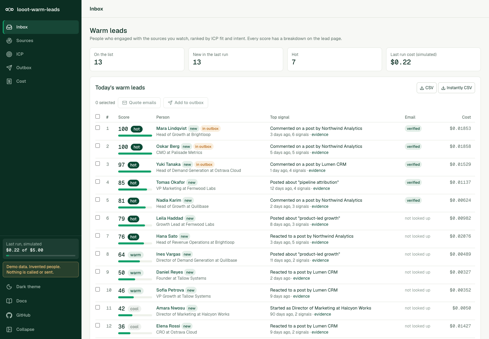

# looot-warm-leads

Warm B2B leads from LinkedIn intent signals, on one [looot](https://looot.ai) key. An open-source alternative to [Gojiberry](https://gojiberry.ai), which lists its Pro plan at $99 a month (read on 2026-10-10).

You name competitors, creators and topics. It finds the people who commented on or reacted to their posts, who posted about the topic, who started a new role, or who work at a company that is hiring or just raised money. It reads their profiles, scores each person against your ICP, and ranks a daily list. Every score shows which signal added how many points, which provider supplied it, what it cost, and a link to check it. You pick leads, see the cost of the email lookup first, and get a verified work email. It drafts a first message that refers to the real signal. Export to CSV or to an Instantly import file. Sending on LinkedIn is optional and goes through your own Unipile account, see below.



## What it is, and what it is not

It is a local tool: a Next.js app, a CLI and a daily GitHub Actions workflow on one engine. State is a JSON file in `.looot-warm/`. There is no hosted service, no database, and no login. Run it on your machine or behind your own auth. It is not a hosted outreach platform: it does not run campaigns for you, and it does not send email.

It does not log in to LinkedIn, does not use a LinkedIn session cookie, and does not automate a browser. The intent data comes from public-data providers through looot. The optional LinkedIn sending goes only through Unipile's hosted auth.

Nothing was run against live looot or Unipile accounts when this was built. See [what is not tested](#what-is-not-tested).

## What Gojiberry does, as read on 2026-10-10

Sources: gojiberry.ai home page and blog index, plus review summaries from Salesforge, HeyReach, G2 and others (several are from competitors, so treat them as direction, not fact). gojiberry.ai/pricing returned 404, so the price below is from the home page.

- Finds "warm leads" from "15+ buying and social signals" and filters them by your ICP. The home page names competitor engagement, people who follow your company, and people active in your space. Reviews add job changes, funding events and post interactions. It also mentions lookalikes.
- Scores leads against your ICP.
- Runs personalised outreach on email and social channels. You can choose full auto or approve each message before it sends. It drafts replies and keeps a unified inbox.
- Claims to learn what converts and to benchmark campaigns.
- Integrations: HubSpot, Pipedrive, an API and an MCP server.
- Price: Pro $99 a month, with 2 AI agents, up to 1,800 prospects contacted a month, a unified inbox, lead scoring, a Copilot mode, email waterfall enrichment from "15+ data providers" and live chat support. A Custom plan for teams of 3 or more has no public price. A free trial is advertised; its length is not stated.

## What you get here, and what you do not

| Gojiberry feature | Here |
|---|---|
| Competitor engagement | Yes. Commenters and reactors on recent posts from competitor company pages. |
| Active in your space | Yes. Authors, commenters and reactors on posts that match your keywords. |
| Creator and post engagement | Yes. Named creators, and specific post URLs. |
| Job changes | Yes, from the profile: a current role that started in the last N days. No separate paid call. |
| Hiring and funding triggers | Yes, optional. PredictLeads through looot, $0.01 per company. |
| ICP scoring | Yes, and each score is itemised. Weights are in `config/warm.config.json`. |
| Email enrichment | One finder and one verifier, with the quote first. Not a 15 provider waterfall. |
| First message per lead | Yes, from templates. An optional LLM rewrite is off unless you set three env vars. |
| Outreach | CSV and an Instantly import file need no extra account. LinkedIn sending is optional through Unipile. No email sending. |
| Follows your company | No. I found no endpoint in the looot catalog that lists a company page's followers. |
| Lookalike leads | No. Not built. |
| Autonomous agents and full auto sending | No, on purpose. Every send needs your approval of the exact text. |
| Learning from conversions, benchmarks | No. |
| AI-drafted replies, unified inbox | No. Replies from Unipile show on the lead page, you answer them in LinkedIn. |
| CRM sync | No. CSV only. |
| Hosted, 3 minute setup | No. You run it. |
| 15+ signals | 12 signal kinds from 7 sources, listed below. |

## Quick start

Needs Node 20 or later.

```bash
git clone https://github.com/loootai/looot-warm-leads.git
cd looot-warm-leads
npm ci --ignore-scripts
npm run demo            # web UI on http://localhost:3281, sample data, no accounts, no token
npm run warm -- run --demo   # the same engine from the CLI, writes ./out
```

Demo mode runs the real engine on invented people and companies, with a stand-in for looot and for Unipile. It makes no network call. Costs shown in demo mode are the list price, booked as simulated spend.

For a real run, edit `config/warm.config.json` (or use the Sources and ICP pages), then:

```bash
export LOOOT_TOKEN=...                          # looot dashboard, Settings, Agent tokens
npm run warm -- run --dry-run                    # prints the list-price cost, makes no call
npm run warm -- run --max-spend 1 --since-last   # runs, writes ./out/warm-<date>.{json,csv,md} and new-<date>.{md,csv}
npm run warm -- leads --limit 20
npm run warm -- email --top 5 --dry-run          # quote for finding and verifying emails
npm run warm -- email --top 5 --max-spend 0.5
npm run warm -- export --format instantly        # only leads with a verified email
npm run dev                                      # the web UI on your own data
```

`examples/sources.example.json` shows the shape of a config with sources. A config file only has to name what it changes; the rest comes from the defaults.

Exit codes: 0 done, 1 error, 2 refused (quote above the cap, no token, no sources).

## How a run works

1. **Sources.** For each competitor page, creator and keyword it lists recent posts. Posts older than `limits.lookbackDays` are dropped.
2. **Engagers.** For the top posts per source (`limits.engagementPostsPerSource`) it reads comments and reactions. For keywords, the authors of matching posts are people posting about the topic.
3. **Pick who to read.** Candidates are ranked by intent so far and by the ICP title in their headline. Titles in `icp.excludeTitles` are dropped. Only the best `limits.maxEnrich` get a profile read. People already read in the last 30 days are not read again.
4. **Profile and company.** Title, current company, role start date and location from the profile. Industry, headcount and domain from the company page.
5. **Triggers.** New role comes from step 4 at no extra cost. Hiring and funding are looked up only for the best `limits.maxTriggerCompanies` companies.
6. **Score and rank.** Fit plus intent, 0 to 100. Leads below `scoring.listMinScore` stay in the file but not on the list. A lead is "new" when it was not on the list in the previous run.

### Scoring

Score = fit points + intent points. Fit is at most `scoring.fitMax` (40), intent at most `scoring.intentMax` (60).

- Fit has up to five checks: title, seniority, industry, location, company size. A check your ICP does not set is left out and the rest are scaled to the fit maximum. A check whose data is missing scores 0 and says so ("no industry in the data"). Nothing is guessed.
- Each intent signal has a weight (its maximum points) and a half-life in days. Points = weight x decay of the newest event, where decay is 0.5 at one half-life. An undated event counts 0.5. Extra events of the same signal add `scoring.repeatBonus` (0.2) of the weight each, up to three. The sum is capped at the intent maximum. When leads tie at the cap, the uncapped sum orders them.
- Bands: hot from `hotAt` (70), warm from `warmAt` (45), otherwise cool.

The breakdown on a lead page lists, for every line: the signal or criterion, the provider, the weight, the points, the date, the cost and links to the evidence. The cost of a call is split across the events it produced. Profile and company reads for fit data are shown on their own line under the table.

## Signals, looot jobs and prices

Prices are per call at looot list price, read from the public catalog on 2026-10-10. A live run reads the current price of every endpoint before it starts, shows it in the quote, and refuses a call whose price it cannot read. The app pins one endpoint per step, so the quoted price is the price charged. All response parsing is written from each endpoint's documented parameters and description, see [what is not tested](#what-is-not-tested).

| Used for | looot job | Endpoint | Per call |
|---|---|---|---|
| Posts of a competitor page | `linkedin.company.posts` | `scrapecreators-linkedin-company-posts` | $0.00188 |
| Posts of a creator | `linkedin.person.posts` | `harvestapi-profile-posts` | $0.004 |
| Posts matching a keyword | `linkedin.post.search` | `harvestapi-post-search` | $0.004 |
| Comments and reactions on a post | `linkedin.post.engagement` | `fetchin-post-engagement` | $0.003 |
| Profile (title, role start, location) | `linkedin.person.profile` | `fetchin-profile` | $0.0015 |
| Company (industry, headcount, site) | `linkedin.company.profile` | `fetchin-company` | $0.0015 |
| Open roles, optional | `jobs.company` | `predictleads-companies-job-openings` | $0.01 |
| Funding events, optional | `company.funding` | `predictleads-companies-financing-events` | $0.01 |
| Work email find | `people.email.find` | `anysite-api-linkedin-user-email` | $0.003598 |
| Email verify | `people.email.verify` | `millionverifier-verify` | $0.00178 |

You can swap the email endpoints in `endpoints.emailFind` and `endpoints.emailVerify`. Other looot catalog entries fit the same jobs, for example `people.job.changes` ($0.108 a call) for a dedicated job-change feed, which this version does not use because the profile already carries the role start date.

### Signal kinds

| Signal | Source | Default weight, half-life |
|---|---|---|
| Commented on a competitor post | competitor pages | 28, 21 days |
| Reacted to a competitor post | competitor pages | 14, 14 days |
| Commented on a creator post | creators | 16, 21 days |
| Reacted to a creator post | creators | 7, 14 days |
| Posted about the topic | keywords | 20, 21 days |
| Commented on a topic post | keywords | 12, 21 days |
| Reacted to a topic post | keywords | 6, 14 days |
| Commented on a watched post | post URLs | 16, 21 days |
| Reacted to a watched post | post URLs | 7, 14 days |
| Started a new role | profile | 18, 60 days |
| Company is hiring a related role | PredictLeads | 10, 45 days |
| Company raised funding | PredictLeads | 10, 120 days |

### What a typical run costs

For 3 competitor pages, 2 creators and 3 keywords with the defaults (2 top posts per source, up to 60 profiles read), at list price, as an upper bound:

| Triggers | Upper bound per run |
|---|---|
| New role only (the default) | $0.25 |
| New role, hiring and funding for up to 20 companies | $0.65 |

The run usually costs less: it reads fewer profiles when the sources return fewer people, and people already read are not read again. A failed call costs nothing. Emails cost $0.0054 per lead at most ($0.003598 to find, $0.00178 to verify, the verify only when an address came back). Email lookups are separate and always quoted first. `npm run warm -- run --dry-run` prints the exact table for your config.

## Money rules

- Every paid action shows its quote first: the Run panel, the email quote, and `--dry-run`.
- A per-run spend cap, `--max-spend` (default $2 for a run, $1 for emails). Before each call the list price is reserved against the cap, so spend cannot pass it. A quote above the cap is refused unless you pass `--partial`.
- Every call carries a stable idempotency key built from the endpoint, the input and the day (emails: lead and step). Running again the same day replays finished calls at no charge.
- A run still in progress when waiting stops is "pending", never "failed at $0". It is counted separately and collected by running again the same day.
- A 401 or 402 from looot stops all later calls in the run.

## Messages, export and Instantly

Drafts come from the templates in `config/warm.config.json` under `messages`, chosen by the strongest signal and filled with the person's first name, company, the signal and the one-line offer you set under `sender`. A draft that still has an unfilled placeholder, or a connection note over `messages.noteMax` (300), carries a warning. The signal the draft refers to is shown above the text.

An optional LLM rewrite runs only when `WARM_LLM=anthropic`, `ANTHROPIC_API_KEY` and `WARM_LLM_MODEL` are all set. It sends the first name, title, company and one signal sentence to the Anthropic API and nothing else. If it fails or returns a note that is too long, the template draft is kept.

`warm export --format csv` writes the ranked list. `--format instantly` writes `email,first_name,last_name,company_name,website,personalization,job_title,linkedin_url,signal,score` for leads whose email was verified deliverable. `personalization` is the first line of the email draft. The extra columns come in as custom variables when you map them in Instantly's import screen (written from Instantly's docs, not tested against an Instantly account). Cells that start with `=`, `+`, `-` or `@` get a leading quote so a spreadsheet does not run them.

## LinkedIn sending through Unipile (optional, off by default)

Sending is not part of looot. It goes through [Unipile](https://www.unipile.com), a paid third-party API, with your own LinkedIn account. looot's catalog has no Unipile entry (checked 2026-10-10), so this app calls Unipile directly with your own key. Without a Unipile account, use the CSV and Instantly exports.

Unipile's public price, read on 2026-10-10 on unipile.com/pricing-api: EUR 49 a month minimum (USD 55) for up to 10 connected accounts, then EUR 5 per account from the 11th, billed after the fact on the peak number of linked accounts, with a 7 day free trial. The page's own FAQ example disagrees with its table in one place, so check it yourself.

**Sending volume is your responsibility under LinkedIn's terms.** LinkedIn limits automated activity and can restrict accounts that exceed it or look automated. Unipile publishes conservative limits (about 80 to 100 invitations a day and 200 a week on a paid account, about 100 profile reads a day, and random spacing during working hours). This app's defaults are lower, but they are only defaults: you set the numbers, and you decide what is acceptable for your account.

What the sender does:

- You pick leads in the inbox and choose Add to outbox. That creates two drafts per lead: a connection request with a note, and a follow-up message for after acceptance. Nothing is approved and nothing sends.
- You review the exact text in the Outbox and approve it per item or per reviewed batch. An approval is tied to a hash of the text you saw. Edit the text afterwards and the approval is void. A batch approval of text that changed since you looked is refused.
- The follow-up waits until the invitation is accepted (Unipile's `new_relation` webhook, or a slow profile check), then for `outbox.followUpDelayHours` plus up to two hours of jitter.
- Caps in `config/warm.config.json`: `dailyInvites` 20, `dailyMessages` 40 (follow-ups), `dailyProfileChecks` 20. Random gap of `minGapSeconds` to `maxGapSeconds` (120 to 480) after every send. A working-hours window (Monday to Friday, 09:00 to 18:00 at the UTC offset you set). A global pause switch. A do-not-contact list of hashes (LinkedIn URL, email or company domain). One send per tick.
- A reply stops the sequence: every pending step for that lead is cancelled, and the reply shows on the lead page. Replies arrive by webhook (`/api/unipile/webhook`, which accepts a request only when its `Unipile-Auth` header equals `UNIPILE_WEBHOOK_SECRET`) or by `warm outbox sync`.
- Sends are idempotent. The item is saved as "sending" before the network call. A definite refusal (HTTP 4xx) is "failed". A rate limit (429) puts the item back and pauses the queue for an hour. An answer the app cannot be sure about (network error, 5xx) becomes "unknown" and is never retried by the app, because the message may have gone out. You check LinkedIn and mark it sent or retry by hand. A second Add to outbox for a lead whose step already went out is refused.
- `outbox.dryRun` is `true` by default. In dry-run, and without `--live`, `warm outbox tick` only prints what would be sent. Live sending needs all of: `UNIPILE_DSN`, `UNIPILE_API_KEY`, a connected account, `outbox.dryRun` set to `false`, and `--live` (or the Send next now button).
- The account is connected only through Unipile's hosted auth link (`warm connect`, or the button on the Outbox page). This app never sees a LinkedIn password or cookie.

Unipile endpoints used, from developer.unipile.com (read 2026-10-10): `POST /api/v1/hosted/accounts/link`, `GET /api/v1/users/{identifier}`, `POST /api/v1/users/invite`, `POST /api/v1/chats`, `GET /api/v1/chats/{chat_id}/messages`, `POST /api/v1/webhooks`. The header is `X-API-KEY`. `POST /api/v1/chats/{chat_id}/messages` is wrapped but the queue does not use it.

Left out because the docs do not say enough: webhook payload signing beyond the custom header, any Unipile idempotency header, and retry-after details on 429. The app handles those cases conservatively instead of guessing.


## Privacy

This tool stores personal data about people who have not asked you to. Keep it small and have a lawful basis before you contact anyone.

- **What is stored:** name, LinkedIn profile URL, headline, current title and company, location text, the signal events (with a snippet of at most 160 characters of a comment, and the post URL), a work email if you looked one up, your drafts, and any reply. Not stored: full profile history, photos, connections, or anything outside what the lead list needs.
- **Lawful basis.** For B2B outreach this is usually legitimate interest (GDPR Article 6(1)(f)), which needs a balancing test, a clear notice at first contact and an easy opt-out. Cold email and automated LinkedIn messages can need consent in some countries (ePrivacy rules, PECR in the UK, CASL in Canada). This is not legal advice. Check your own situation.
- **Deletion.** `npm run warm -- forget <linkedin url or email>` erases the lead and its outbox items and keeps only a hash on a suppression list, so later runs do not add the person back. The Erase button on a lead page does the same.
- **Do not contact.** `warm dnc <url, email or domain>` stores a hash only and cancels pending messages for that person.
- **Retention.** `privacy.retentionDays` (90) is used by `npm run warm -- purge`, which deletes leads not seen for that long. A purged lead that you had contacted leaves its hash on the suppression list so you cannot message them twice by accident. Run `purge` on a schedule if you want retention enforced.
- **Where data goes.** looot and its providers receive the LinkedIn URLs and search terms you query. Unipile receives your messages if you turn sending on. The optional LLM step sends one lead's first name, title, company and signal sentence to Anthropic.
- **GitHub Actions.** The daily workflow keeps its state in the Actions cache and the reports in a 7 day artifact, both private to the repository. Use a private repository, or delete the cache after each run.
- **Demo data** is invented. No real person or company is in this repository.

## Daily GitHub Actions workflow

`.github/workflows/daily.yml` runs every day at 06:17 UTC and on demand. It installs without install scripts, restores the list from the last run, prints the free quote, and, only if a `LOOOT_TOKEN` repository secret exists, runs `warm run --since-last`, writes the new warm leads to the job summary, saves the list for the next run, and uploads the reports for 7 days. Without the secret it spends nothing and says why. It never sends anything to LinkedIn or by email. Commit your sources to `config/warm.config.json` first. The workflow passes `actionlint`.

## Install for agents

```bash
git clone https://github.com/loootai/looot-warm-leads.git && cd looot-warm-leads && npm ci --ignore-scripts
npm run warm -- run --dry-run        # show the user this quote first
npm run warm -- run --max-spend 1    # needs LOOOT_TOKEN; exit 2 means refused
npm run warm -- leads --new
```

[llms.txt](llms.txt) describes the files and rules for agents. A Claude Code skill is in [skills/looot-warm-leads/SKILL.md](skills/looot-warm-leads/SKILL.md): copy the folder to `~/.claude/skills/` or to a project's `.claude/skills/`. An agent must quote first, must not raise the cap without the user's word, must never approve or send a LinkedIn message for the user, and must say that no paid run has been verified against real provider responses.

## Configuration

`config/warm.config.json` holds everything you tune: the ICP, sources, triggers, every signal weight and half-life, the fit weights, the band thresholds, limits per run, the email endpoints, your sender text, the message templates, the outbox caps and the retention period. The web app saves edits to `.looot-warm/config.json`, which wins over the shipped file. `WARM_CONFIG=path` or `--config path` picks another file.

Environment variables are in `.env.example`. The app does not read `.env` files; export them in your shell.

## Development

```bash
npm test            # vitest, all HTTP mocked
npm run typecheck
npm run lint
npm run build
npm run leak-scan   # secrets, private hosts, personal emails; also runs as a pre-commit hook after `git config core.hooksPath .githooks`
```

Layout: `src/engine` (looot client, meter, discovery, scoring, drafts, exports, state), `src/sender` (Unipile client and the outbox), `src/server` (service layer shared by the CLI and the API routes), `src/cli`, `src/app` and `src/components` (UI).

## What is not tested

- **No paid looot run was made.** The parsers for post lists, engagers, profiles, companies, jobs, funding, emails and verifier results are written from each endpoint's documented parameters and description and from fixtures I wrote. Field names in real responses may differ. A parse that finds nothing is reported as no data, not as a failure, so check the first real run by eye.
- **No Unipile call was made.** There was no Unipile account. The client is tested against mocked HTTP built from Unipile's public docs, not against the service. The hosted auth callback, the webhook payloads and the chat flow are unverified against a live account.
- **No Instantly import was tried.** The column format follows the field names in the `looot-instantly` repo and Instantly's documentation.
- The web UI was exercised in demo mode and in headless Chrome screenshots. The live paths (real looot token, real Unipile) were not clicked through.
- Engagement data on LinkedIn is incomplete: providers return a sample of commenters and reactors, not all of them, and reaction dates are the post's date when the provider gives none.

## Licence

MIT, copyright looot. See [LICENSE](LICENSE). This project is not affiliated with Gojiberry, Unipile, LinkedIn or Instantly. Names are used to say what this replaces or works with.

## Related

Other open-source projects built on [looot](https://looot.ai):

- [looot-intent](https://github.com/loootai/looot-intent): account intent and buying-stage scoring (6sense)
- [looot-score](https://github.com/loootai/looot-score): lead and ICP fit scoring (MadKudu)
- [looot-reveal](https://github.com/loootai/looot-reveal): which companies visit your site (RB2B, Clearbit Reveal)
- [looot-techstack](https://github.com/loootai/looot-techstack): website technologies from several providers (BuiltWith, Wappalyzer)
- [looot-signals](https://github.com/loootai/looot-signals): hiring, funding and news triggers (TheirStack, Harmonic)
- [looot-lookalike](https://github.com/loootai/looot-lookalike): lookalike company search (Ocean.io)
- [looot-ads](https://github.com/loootai/looot-ads): competitor ad board (Foreplay)
- [looot-reviews](https://github.com/loootai/looot-reviews): review themes and weak spots (ReviewTrackers)
- [looot-battlecards](https://github.com/loootai/looot-battlecards): competitor battlecards (Klue, Crayon)
- [looot-mentions](https://github.com/loootai/looot-mentions): brand and keyword listening (Brand24)
- [looot-crm](https://github.com/loootai/looot-crm): a small CRM with buying signals built in
- [looot-seo](https://github.com/loootai/looot-seo): self-hosted SEO workspace
- [looot-monitor](https://github.com/loootai/looot-monitor): brand and competitor monitoring with alerts
